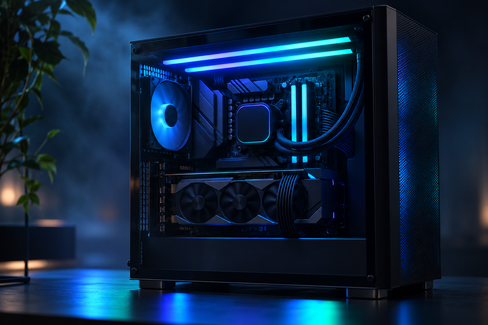
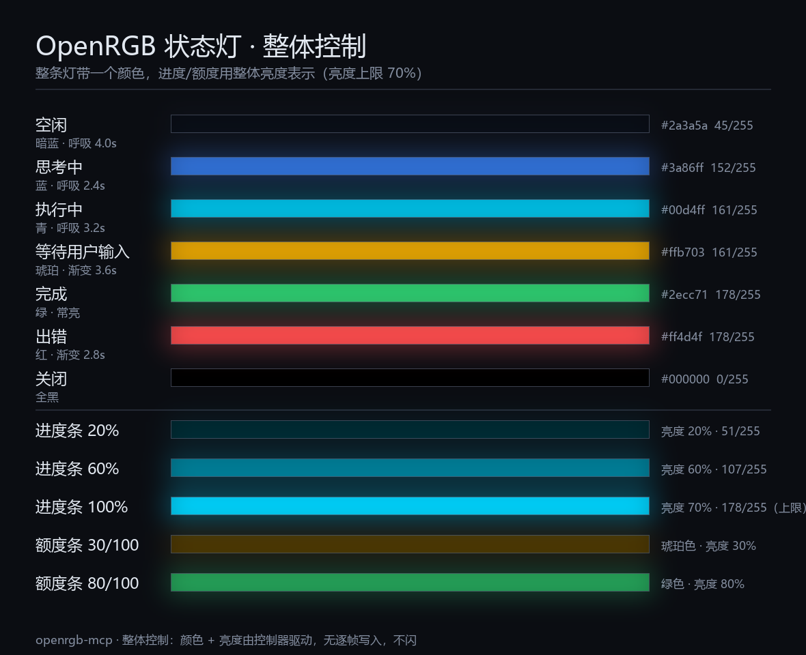

# OpenRGB 状态灯 MCP



把 AI 的会话状态（思考 / 执行 / 进度 / 完成 / 出错）实时同步到 OpenRGB 控制的机箱灯光（风扇、灯条、灯带均可）。

## 安装

```bash
# 方式一：pipx / uvx（推荐，全局命令）
pipx install git+https://github.com/sheetung/openrgb-mcp.git
uvx --from git+https://github.com/sheetung/openrgb-mcp.git openrgb-mcp

# 方式二：仓库内虚拟环境
git clone https://github.com/sheetung/openrgb-mcp.git
cd openrgb-mcp
python -m venv .venv
.venv/bin/pip install -e .        # Windows: .venv\Scripts\pip install -e .
```

启动：

```bash
openrgb-mcp                                   # stdio（本地客户端）
openrgb-mcp --transport streamable-http --port 8765   # HTTP
```

接入 DeepSeek Harness：在 `%USERPROFILE%\.dsh\profiles\<profile>\cordis.patch.yml` 里追加一条
（完整说明见 [`install/mcp-config.example.yml`](install/mcp-config.example.yml)），保存后热加载、无需重启：

```yaml
- insert:
    - id: magpie-mcp-openrgb
      name: "@deepseek-ai/dsh-mcp-client"
      config:
        serverName: "openrgb"
        transport: "stdio"
        command: "<openrgb-mcp 可执行文件的绝对路径>"
        toolCallTimeoutMs: 20000
```

前置条件：OpenRGB 正在运行且 SDK Server 已启用（端口自动发现：环境变量 `OPENRGB_PORT` →
OpenRGB 日志记录的端口 → 默认 6742）。

## MCP 结构

### 工具（tools）

模型侧工具名为 `mcp__openrgb__<tool>`。

| 工具 | 参数 | 执行的动作 |
|---|---|---|
| `list_devices` | — | 读设备清单：设备名、zone 分区、模式、灯珠数量 |
| `status` | — | 读当前状态：state、灯珠数、端口、渲染路径、最近错误 |
| `set_state` | `state`：`idle` `thinking` `working` `waiting` `done` `error` `off`；`detail` 说明（仅记录）；`animate` 是否动画 | 切状态 → 按下表改变颜色与效果 |
| `set_progress` | `percent` 0–100，或 `done`+`total`；`color`、`state`、`detail` | 进度 → 灯光亮度按比例变化（整体控制），或点亮前 N 颗（逐灯模式） |
| `set_quota` | `remaining`、`total`；`detail` | 剩余额度 → 亮度按剩余比例，颜色分三档（>50% 绿 / 20–50% 琥珀 / ≤20% 红） |
| `set_color` | `color` `#RRGGBB`；`brightness` 0–1 | 整组灯光设为单色 |
| `set_leds` | `colors`：`#RRGGBB` 数组，长度 = 灯珠数 | 逐灯珠颜色（仅逐灯模式可用） |
| `set_effect` | `effect`：设备自带模式名（如 `Breathing`、`Static`、`Wave`）；`color` | 切换到设备硬件效果，停止状态动画 |
| `restore` | — | 恢复首次接管前的原始灯效 |

### 状态 → 灯光行为

| state | 颜色 | 效果 | 备注 |
|---|---|---|---|
| `idle` | `#2a3a5a` 暗蓝 | 缓慢呼吸 4.0s | 默认空闲态 |
| `thinking` | `#3a86ff` 蓝 | 呼吸 2.4s | 开始推理 |
| `working` | `#00d4ff` 青 | 呼吸 3.2s | 执行工具 / 改文件 |
| `waiting` | `#ffb703` 琥珀 | 明暗渐变 3.6s | 等你回答 |
| `done` | `#2ecc71` 绿 | 常亮 | 8s 后自动回 `idle` |
| `error` | `#ff4d4f` 红 | 明暗渐变 2.8s | 失败 / 异常 |
| `off` | 全黑 | — | 关灯 |



所有动画都是连续曲线，没有硬切换，**不频闪**；颜色、亮度、速度由控制器自己执行，不逐帧重写灯珠。

### 资源（resources）

| URI | 内容 |
|---|---|
| `openrgb://status` | 当前灯效状态 JSON |
| `openrgb://devices` | 设备 / 分区 / 模式清单 JSON |

### 提示词（prompt）

`status-lamp` —— 说明如何把对话状态映射到灯光，供客户端一键载入。

### 配置（`config.json`）

| 键 | 说明 |
|---|---|
| `control` | `global`（默认，整组灯光一个颜色 + 亮度）或 `per_led`（逐灯珠，仅可寻址设备） |
| `max_brightness` | 亮度上限，默认 `0.7`（约 178/255） |
| `brightness` | 全局亮度系数 |
| `done_hold_seconds` | `done` 保持多久后回 `idle`，默认 8 秒 |
| `palette` | 覆盖各状态的颜色 / 亮度 / 效果 / 周期 |

环境变量：`OPENRGB_PORT`、`OPENRGB_DEVICE`、`OPENRGB_MCP_CONFIG`、`OPENRGB_MCP_STATE`。

> 同一时间只让一个程序控制灯光（例如厂商灯控软件），否则会互相覆盖。

## 许可

本项目以 **GPL-3.0** 发布（见 [LICENSE](LICENSE)）。

- [OpenRGB](https://openrgb.org/)（GPLv3）——提供 SDK Server 与硬件控制，本项目通过其公开网络协议交互。
- [openrgb-python](https://github.com/jath03/openrgb-python)（jath03，GPLv3）——开发期间作为 **v4 协议线格式的参考实现**；本仓库的客户端为独立实现，未复制其源码。
- [Model Context Protocol Python SDK](https://github.com/modelcontextprotocol/python-sdk)（MIT）——本项目的 MCP 运行时。
